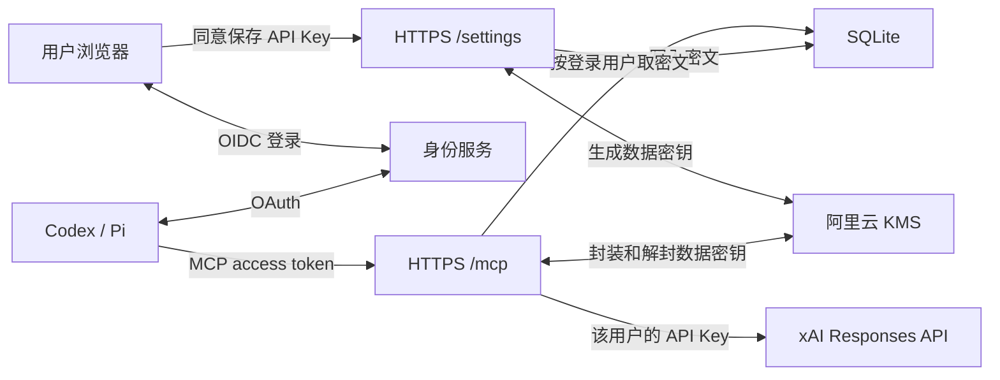

# 多用户 X Search MCP

一套 HTTPS MCP 地址供受邀用户连接。用户在客户端授权访问 MCP，再用同一个身份到设置页绑定自己的 xAI API Key。服务根据 OAuth 签发方和用户 ID 查找绑定，每次搜索使用该用户的 xAI API 额度。



当前多人模式的上游认证使用 xAI API Key。Grok 订阅需要验证官方 OAuth 客户端和 X Search 权限，现有个人模式的 `auth login` 用于独立的单用户进程。 [xAI X Search](https://docs.x.ai/developers/tools/x-search) · [Grok OpenCode 集成](https://x.ai/news/grok-opencode)

## 服务端配置

1. 准备有效的 HTTPS 证书和一个专用主机名。以下用 `https://mcp.example.com/mcp`。MCP 客户端 URL、OAuth resource indicator 和 access token 的 `aud` 必须与此完全一致，包括路径和末尾斜杠。
2. 选择支持 MCP OAuth 的授权服务器。例如在同一个 WorkOS AuthKit 环境里配置该 resource indicator，按目标客户端启用 CIMD 或 DCR。给设置页另建一个 confidential Connect OAuth 应用，启用 `openid`，回调地址填 `https://mcp.example.com/settings/callback`。后端使用 authorization code、S256、`client_secret_basic` 和签名 ID token。该 ID token 与 MCP access token 必须使用相同的 `iss` 及用户 `sub`。邀请名单填签发方的用户 ID。MCP access token 需要 `client_id`、配置的 scope、有效期，以及唯一且指向此 MCP 的 audience。默认 scope 是 WorkOS 动态客户端支持的 `openid`，可以改成签发方能授予的专用 scope。 [WorkOS MCP 配置](https://workos.com/docs/authkit/mcp) · [WorkOS Connect token claims](https://workos.com/docs/authkit/connect/token-claims)
3. 为应用准备一个阿里云对称 KMS 主密钥。ECS RAM 角色仅授予指定密钥的 `kms:GenerateDataKey` 和 `kms:Decrypt`，使用 IMDSv2。KMS 默认使用区域 VPC 端点。按所选 KMS 实例配置该网关及访问权限。专属网关使用 `X_SEARCH_MULTI_USER_KMS_ENDPOINT` 指定实例域名，并用 `X_SEARCH_MULTI_USER_KMS_CA_FILE` 指定实例的 CA PEM 文件。检查同机服务能否访问实例元数据。对外托管建议使用专用工作负载和隔离权限。 [KMS 网关和 CA](https://www.alibabacloud.com/help/en/kms/key-management-service/developer-reference/initialize-the-client-1) · [ECS 接入 KMS](https://www.alibabacloud.com/help/en/kms/key-management-service/ecs)
4. 以独立服务用户运行 Node.js，给数据库创建该用户所有的 `0700` 目录。将设置页 OIDC client secret 放入该用户所有的 `0600` 文件。用进程管理器传入以下变量。若使用 systemd，可使用 `StateDirectoryMode=0700`、`UMask=0077` 和 `LimitCORE=0`，并给服务传入 `EnvironmentFile=`。

```dotenv
X_SEARCH_MULTI_USER_PUBLIC_URL=https://mcp.example.com/mcp
X_SEARCH_MULTI_USER_ISSUER=https://your-environment.authkit.app
X_SEARCH_MULTI_USER_JWKS_URL=https://your-environment.authkit.app/oauth2/jwks
X_SEARCH_MULTI_USER_SCOPE=openid
X_SEARCH_MULTI_USER_ALLOWED_SUBJECTS=user_REPLACE_ALICE,user_REPLACE_BOB
X_SEARCH_MULTI_USER_OIDC_CLIENT_ID=client_REPLACE
X_SEARCH_MULTI_USER_OIDC_CLIENT_SECRET_FILE=/var/lib/x-search-mcp/settings-client-secret
X_SEARCH_MULTI_USER_DATABASE=/var/lib/x-search-mcp/credentials.sqlite
X_SEARCH_MULTI_USER_KMS_REGION=cn-hangzhou
X_SEARCH_MULTI_USER_KMS_KEY_ID=key-REPLACE
X_SEARCH_MULTI_USER_KMS_ROLE_NAME=x-search-mcp-kms
```

```sh
x-search-mcp http --multi-user --port 8000
```

生产环境启动命令需要该主机上的 KMS 访问。开发联调可以用 `--dev-local-key` 与 `X_SEARCH_MULTI_USER_DEV_KEY_FILE`，将一个随机生成、由服务用户所有且权限为 `0600` 的 32 字节文件用作本地包装密钥。测试库和生产库分别建立。授权服务器的 discovery、JWKS 和 token 交换走独立直连。xAI API 请求可经现有的 Oracle 出站代理。KMS 通过配置的阿里云端点访问。

## HTTPS 入口

Node 监听回环地址。下面是放入 Nginx HTTPS `server` 块的例子。另将 HTTP 请求重定向至 HTTPS，并在安全组保留必要的公网端口。如果现有单账号服务还在运行，给多人服务分配独立的回环端口，代理指向多人服务。

```nginx
# In the http context
map $uri $x_search_auth_client {
    default "";
    /settings/login $binary_remote_addr;
    /settings/callback $binary_remote_addr;
}
limit_req_zone $x_search_auth_client zone=x_search_login:10m rate=12r/m;

server {
    listen 443 ssl;
    server_name mcp.example.com;
    ssl_certificate     /path/to/fullchain.pem;
    ssl_certificate_key /path/to/privkey.pem;
    access_log off;
    error_log /var/log/nginx/x-search-mcp-error.log crit;

    location ~ ^/(mcp|\.well-known/oauth-protected-resource(?:/mcp)?|settings(?:/(?:login|callback|key|unbind|logout))?)$ {
        limit_req zone=x_search_login burst=10 nodelay;
        limit_req_status 429;
        client_max_body_size 1m;
        proxy_pass http://127.0.0.1:8000;
        proxy_set_header Host mcp.example.com;
        proxy_set_header Authorization $http_authorization;
        proxy_http_version 1.1;
        proxy_buffering off;
        proxy_request_buffering off;
        proxy_read_timeout 620s;
    }
    location / { return 404; }
}
```

入口的登录限流按客户端地址计算。经过额外网关时，仅信任该网关提供的来源地址。公网入口关闭请求正文、Cookie 和 Authorization 采集。搜索默认每个用户每分钟最多 30 次、同时 2 次。保存或替换每个用户每分钟最多 5 次、同时 1 次。设置页会话保存在单进程内，重启后需要重新登录设置页，已加密绑定会保留。

## 用户使用

1. 用支持 OAuth 的 MCP 客户端添加服务器 URL 并授权。
2. 在浏览器打开 `https://mcp.example.com/settings`，使用第一步的同一个账号登录，输入 xAI 控制台生成的 API Key 并同意加密保存。
3. 在客户端调用 `x_search`。遇到缺少绑定或 xAI 返回 401，工具会附上设置页地址。用户可以在设置页替换或删除自己的 Key。

```sh
codex mcp add x-search --url https://mcp.example.com/mcp
# 需要单独启动授权时
codex mcp login x-search

pi mcp add x-search --url https://mcp.example.com/mcp
pi mcp login x-search
pi mcp list
```

## 凭证和运行数据

- SQLite 存储用户标识、绑定版本、AES-256-GCM 密文和 KMS 封装后的数据密钥。封装与密文都绑定当前用户和记录版本。
- 用户的 Key 会在保存和实际发起 xAI 请求时进入应用进程内存。拥有运行中进程控制权或可同时读取数据库并使用解密权限的人，仍可能使用这些 Key。
- MCP 客户端从身份服务获取 MCP token。浏览器设置页只保留短期会话和用户标识。多人模式停止写入本地搜索查询和原始响应日志。
- 解绑对后续搜索生效，已发送的请求可能继续执行。旧备份仍可能包含历史密文。需要立即让旧 Key 失效时，在 xAI 控制台吊销它。恢复备份时检查哪些绑定在备份日期之后被移除。
- 正式开放前，用两名受邀用户验证真实登录、KMS 加解密、真实 X Search、费用归属和备份恢复。验证公开入口只连接多人实例。 [MCP 授权规范](https://modelcontextprotocol.io/specification/2026-07-28/basic/authorization)
